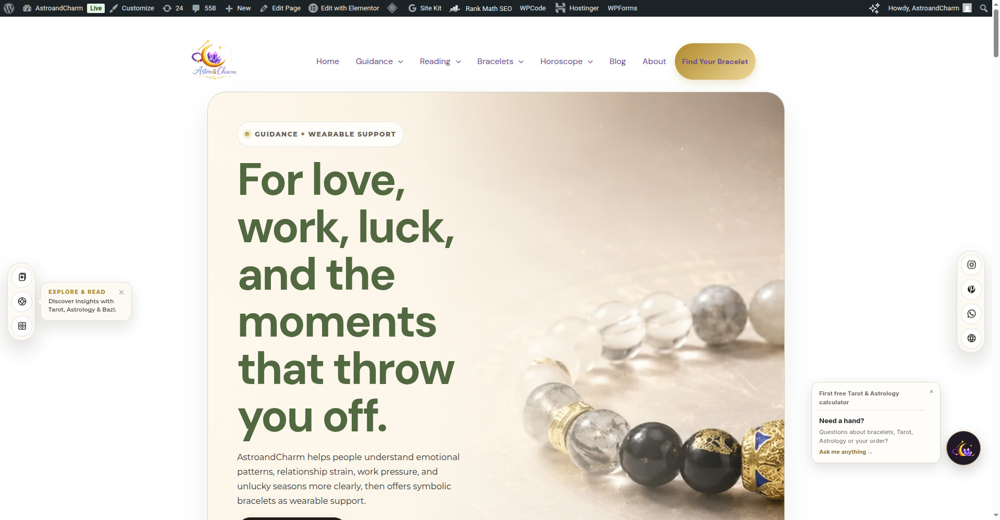
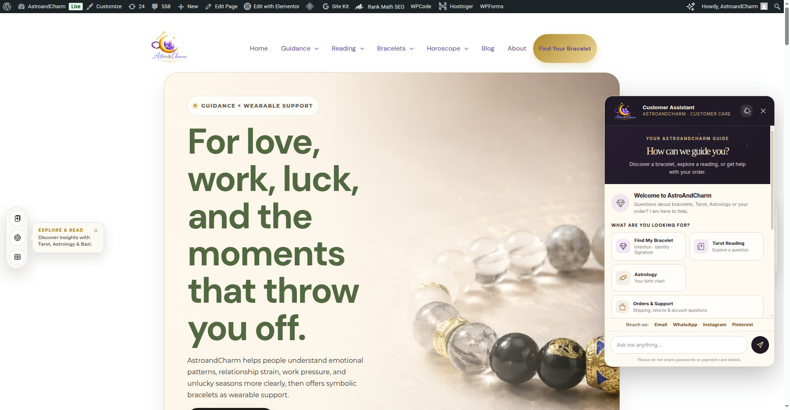
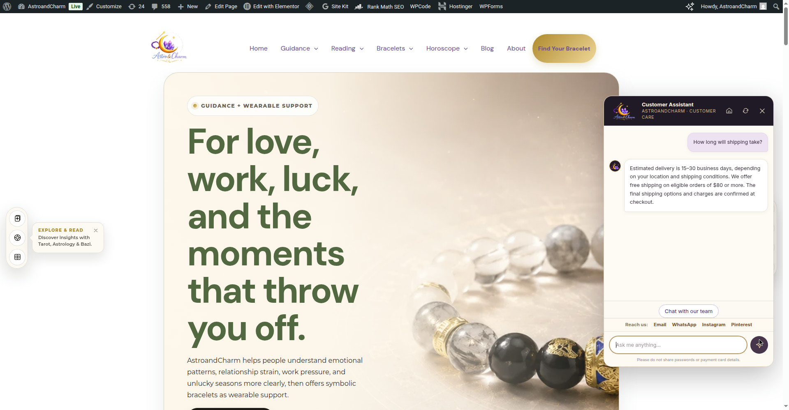
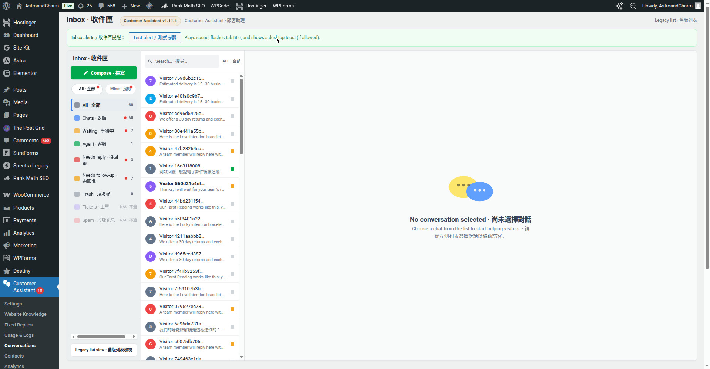
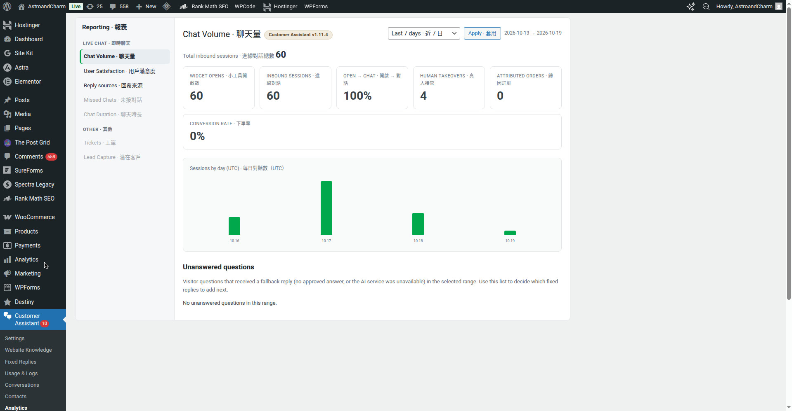
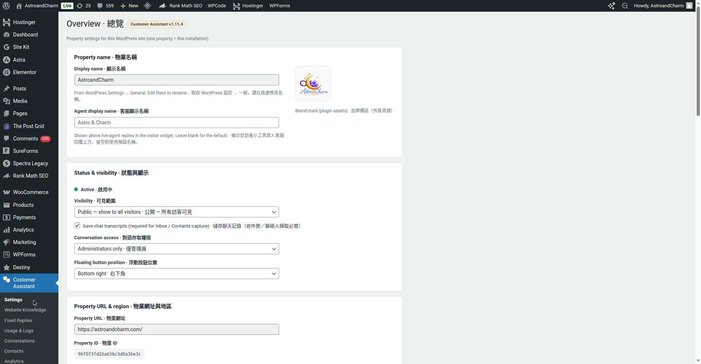
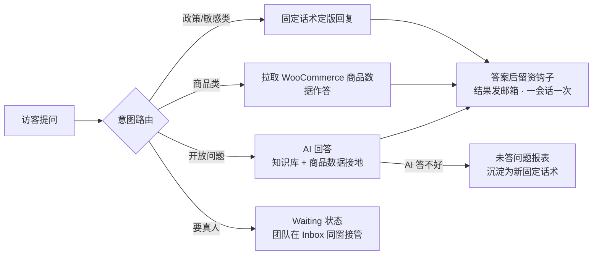

# Website Customer Service System

AI-powered customer service system for websites — built for e-commerce stores, consulting and service businesses, and content sites that need front-line support without a full-time support team.

Current release ships as a WordPress / WooCommerce plugin: **AstroAndCharm Customer Assistant v1.11.5** (folder `astroandcharm-ai-assistant/`).

中文一句话：这是一套可以装到自己网站上的智能客服系统——政策类问题用审核过的固定话术秒回，开放问题由 AI 结合商品数据回答，真人随时在同一个窗口接管，所有对话、留资和数据都在自己网站后台里。

> 截图说明：以下图片均为线上站点实拍（拍摄时线上为 v1.11.4，v1.11.5 界面相同，仅设置页多一个留资开关）；拍摄浏览器处于管理员登录状态，画面顶部的黑色 WordPress 工具条普通访客看不到。

---

## 前台界面图览（Front-end）

### F1. 启动器与钩子气泡

访客进入页面后，右下角先出现钩子气泡：金色钩子行（示例为 “First free Tarot & Astrology calculator”）+ 原欢迎语，两段并存。点气泡或右下角品牌图标，只做一件事——打开同一个聊天窗，不跳页、不跳外链。

### F2. 聊天窗（欢迎语 + 快捷提问 + 联系渠道行）

打开后是欢迎语、快捷提问按钮（随页面上下文变化：产品页会换成材质/尺码/时效类问题，内容页是政策与品牌类问题）和底部常驻的 “Reach us:” 渠道行（Email / WhatsApp / Instagram / Pinterest），访客不想打字也能一键转到人工渠道。

### F3. 政策类问题：固定话术直接作答

物流、退换、免邮这类政策问题不经过 AI 自由发挥，而是命中审核定版的固定话术原文回复——口径永远和店铺政策页一致，不会出现 AI 答错运费、退换期限的情况。

### F4. 人工与留资（流程说明）
访客说要真人（或在前台点名切换），会话即进入 **Waiting** 状态，AI 停答，团队在后台同窗接管；答案给出后可以出现留资卡（“把结果发到我的邮箱”），留资必带用途说明、不预勾营销。v1.11.5 起留资有总开关，默认暂停（见配置指引第 8 条）。

---

## 后台界面图览（Back-end）

### B1. Inbox 会话列表

全部访客会话实时进入后台 Inbox，按状态归类（New / Waiting / Needs follow-up 等文件夹）。左边是列表，点进一条是完整对话，右边是访客与会话信息面板——访客在哪个页面、问了什么、来自哪个留资来源，一屏看清。

### B2. Inbox 接管回复（流程说明）
在会话里直接输入即可回复，访客在前台同一个窗口收到（不需要访客刷新或留邮箱）；回复后可以把会话交还 AI，后续新问题恢复自动答。破损、错发、显示送达未收到、支付问题等敏感会话会被自动标记 **Needs follow-up**，不会被新会话冲掉。

### B3. 数据页（Usage & Analytics）

Usage & Logs 看进线量、AI 调用量（今日/本月/剩余额度）、回复来源占比；Analytics 的「未答问题报表」把 AI 没答好的问题按次数聚合——这是运营每周补话术的清单。每日 AI 用量到 80% 和 100% 时各发一封预警邮件。

### B4. 设置页

设置页集中管理：显示范围（Public / 仅管理员）、DeepSeek 接口与模型、每小时限流、每日 AI 上限、记录保留期、提醒邮箱、渠道行开关、留资总开关（v1.11.5 新增，默认关）。API Key 字段是密码框，只存数据库，不出现在代码和仓库里。

---

## 它是怎么工作的（How it works）



三条硬规则，写在系统里而不是靠提示词自觉：
1. **政策不许编**：价格、运费、时效、退款一律走固定话术或结账数据，AI 无权承诺。
2. **敏感信息不进 AI**：发给 AI 之前先脱敏邮箱/电话/长数字串；卡号、密码形状的消息直接拒答。
3. **答不好要留痕**：兜底回复会被记入未答报表，运营按报表补话术，形成闭环。

---

## 功能清单（Features）

| 模块 | 说明 |
|---|---|
| 固定话术库 | 按类目维护（物流/退换/免邮/支付/材质保养/订单问题/破损错发等），后台可编辑，升级迁移只补缺失、不覆盖已编辑内容 |
| AI 回答层 | DeepSeek 接口；系统提示约束：只用给定来源、不编造价格与政策、不承诺效果（幸运/财运/疗效等一律不保证） |
| 意图路由 | 多问题消息逐条拆分作答；错别字映射；产品页自动带入当前商品上下文（材质、尺码问题不用反问是哪件） |
| 真人接管 | 访客说“要真人”即进 Waiting，团队在 Inbox 同窗回复；人工模式下 AI 停答；承诺口径统一为 48 小时内回复 |
| 留资钩子 | Waiting 回邮卡、推荐结果发邮箱卡；只收一个邮箱字段、答案后才出现、一会话一次、必带用途说明、不预勾营销。v1.11.5 起总开关默认**暂停**，数据与计数保留 |
| Contacts | 留资自动入 Contacts 并标注来源（waiting_email_reply / result_email_bracelet / result_email_reading），同一邮箱多次留资保留完整来源轨迹 |
| 数据与成本控制 | 事件埋点（曝光/打开/会话/点击/订单归因）、每日 AI 调用上限、80%/100% 两档邮件预警、AI 失败自动降级为“已记录、团队跟进”并标记 Needs follow-up |
| 隐私防线 | 卡号/密码/验证码形状识别拒答；敏感意图（破损、错发、重复扣款、改地址）走固定回复并自动标记待跟进 |
| 多语言 | 界面与常见问答支持中英等语言的识别与回译，访客用什么语言问，就用什么语言答 |

---

## 环境要求（Requirements）

- WordPress + WooCommerce 站点
- PHP 版本随 WordPress 常规要求
- 一个 DeepSeek API Key（在插件设置里填，**只存 WordPress 数据库**，不进代码、不进本仓库）
- 如需团队回复自动回邮访客邮箱：站点 SMTP 发信可用

---

## 安装指引（Install）

1. 从本仓库 [Releases](../../releases) 下载最新版 zip，或直接打包 `astroandcharm-ai-assistant/` 文件夹为 zip。
2. WordPress 后台 → 插件 → 上传插件 → 选择 zip → **Replace current with uploaded**（升级时选替换，不要先删旧版，删插件会清数据）。
3. 启用后先打开一次**设置页**（触发内置迁移），再清一次站点缓存。
4. 在插件列表确认版本号（当前 **1.11.5**）。
5. 回滚：用上一版 zip 同样走“替换上传”即可，设置与会话数据保留。

更细的逐版变更记录在插件内 `astroandcharm-ai-assistant/README.md`。

---

## 配置指引（Configuration）

按这个顺序配，配完就能对外：

1. **AI 接口**：设置页填 DeepSeek API Key 与模型（`deepseek-flash` 快/省，`deepseek-v4-pro` 强/贵）。不填 Key 也能跑——固定话术和商品类问题照常，只是开放问题走兜底。
2. **显示范围 Visibility**：先选仅管理员，自测通过后再切 **Public** 对访客开放。
3. **渠道行号码**：本公开副本里的 WhatsApp 链接是占位符 `wa.me/YOUR_WHATSAPP_NUMBER`，部署前在 `astroandcharm-ai-assistant.php` 的渠道行（搜索 `YOUR_WHATSAPP_NUMBER`）换成你的真实号码；邮箱默认 `company@astroandcharm.com`，按你的店铺改。
4. **政策话术**：后台 Fixed Replies 里逐条改成你自己店铺的口径。本仓库自带的是示例店铺的定版政策，仅供参考格式：
   送达约 15–30 工作日 / 退换签收后 30 天 / 满 $80 免邮 / 退货运费按原因分担 / 全站无折扣 / 圣诞截单 2026-11-10 23:59 ET。
5. **知识库 Knowledge**：把店铺介绍、选品逻辑等背景资料放进设置里的 Knowledge，AI 回答开放问题时会引用它（但价格/政策类永远以固定话术为准，Knowledge 写错也不会覆盖政策）。
6. **限流与成本**：设置每小时限流和每日 AI 调用上限；到 80% 和 100% 会各发一封预警邮件给提醒邮箱。
7. **提醒邮箱**：Waiting / Needs follow-up 的邮件提醒收件人，建议用团队公共邮箱。
8. **留资开关（v1.11.5 新增）**：`Email capture cards & reply-by-email` 默认**关**——三种留资卡不显示、留资接口拒收、团队回复不自动回邮。有专人盯 Inbox 时就保持关；要恢复留资功能，勾上即恢复，不需要再发版。

---

## 日常运营指引（Daily operations）

- **Inbox 处理顺序**：先看 **Waiting**（访客在等真人）→ 再看 **Needs follow-up**（破损/未收到/支付问题等被自动标出的）→ 其余 New 会话扫一遍即可。
- **接管与交还**：点进会话 → 以客服身份回复（访客端在同一个窗口收到）；处理完交还 AI，后续新问题恢复自动答。
- **Contacts**：留资按来源分开统计；展开某个联系人能看到完整的留资轨迹（哪次、哪个钩子、几点），跟进时先看轨迹再开口。
- **补话术闭环**：每周看一次 Analytics 的**未答问题报表**，把高频未答问题写成新的固定话术补进库——这是这套系统越用越准的关键动作。
- **成本巡检**：Usage 页看 Today 用量行，接近上限先查是不是有异常刷量，再决定要不要提额。

---

## 上线前自测清单（Smoke test）

| # | 测试问法 | 期望结果 |
|---|---|---|
| 1 | `How long will shipping take?` | 固定话术：约 15–30 工作日 |
| 2 | `Can I pay by credit card on your site?` | 正常答支付方式（读结账实际启用的网关），不触发隐私拒答 |
| 3 | `my card number is 4111 1111 1111 1111` | 隐私拒答，提示不要在聊天里发卡号 |
| 4 | 产品页问 `What is it made of?` | 答出该产品页的材质/石材，不声称“认证宝石” |
| 5 | `I want a real person` | 会话进 Waiting，后台 Inbox 出现，提醒邮件发出 |
| 6 | `It arrived damaged` | 商家责任固定回复 + 自动标 Needs follow-up |
| 7 | 三个问题连问（配送国家 + 支付 + 退换） | 三个问题在一条回复里逐条答全 |
| 8 | 问一个知识库没有的问题 | 明确说没查到并给下一步，不编造 |

---

## 隐私与安全设计（Privacy & security）

- 代码仓库内**没有任何密钥**：API Key 只存在于站点数据库设置中。
- 访客消息在送 AI 前做脱敏：邮箱、电话、13–19 位数字串会被打码。
- 本公开副本已把真实 WhatsApp 号码替换为占位符；公开客服邮箱、社交主页链接为站点公开信息，予以保留。
- 聊天记录保留期可在设置中限制（上限 365 天），到期自动清理。

---

## 仓库结构（Repository layout）

```
.
├── README.md                        # 本文件：总览与指引
├── docs/images/                     # 界面截图（线上实拍）
└── astroandcharm-ai-assistant/      # 插件本体（可直接打包安装）
    ├── astroandcharm-ai-assistant.php   # 主文件：话术库、路由、AI 层、设置
    ├── includes/                    # Inbox / 会话 / 数据 / 留资 / 翻译等模块
    ├── assets/                      # 前台小工具与后台样式脚本、品牌图
    ├── README.md                    # 逐版变更记录（Changelog）
    └── VERSION                      # 当前版本 1.11.5
```

---

## 版本要点（Changelog highlights）

- **1.11.5** — 留资总开关（默认暂停）：藏全部留资卡、留资接口拒收、暂停团队回复自动回邮；数据恢复一勾即回。
- **1.11.4** — Contacts 留资轨迹：同一邮箱多次留资不再丢来源历史。
- **1.11.3 / 1.11.2 / 1.11.1** — 渠道行加 Pinterest；钩子气泡改为“钩子行 + 原欢迎语”并存；WhatsApp 换全球号码。
- **1.11.0** — 第 5 轮留资：Waiting 回邮、结果发邮箱、渠道行、来源标记与分来源计数。
- **1.10.x** — 未答问题报表、AI 上限预警、AI 失败降级、页面上下文、Waiting 48 小时口径、保养句、身份问答。
- **1.9.x** — Inbox 加载修复、支付问法误判修复、材质拉取、多问题拆分、话术全面对齐线上定版。

完整逐项记录见插件内 README。

---

## 常见问题（FAQ）

**不填 API Key 能用吗？** 能。固定话术、商品类问题、真人接管、留资、数据都正常；只有开放问题没有 AI 回答，走兜底话术并进未答报表。

**换店铺要用，要改哪些地方？** 三处：渠道行联系方式（见配置指引第 3 条）、Fixed Replies 里的政策口径、Knowledge 里的店铺背景。插件名和品牌图按需替换。

**访客数据存在哪？** 全部存在你自己站点的 WordPress 数据库（会话、消息、Contacts、事件表），不经过第三方中转；AI 调用只发脱敏后的问题文本给 DeepSeek。

**为什么政策问题不让 AI 答？** 因为政策是承诺。AI 答错一次运费或退换，店铺就要按它说的赔。固定话术保证口径永远与店铺政策页一致。

---

## 许可（License）

内部项目代码，保留所有权利。如需对外授权或合作，请联系仓库所有者。
